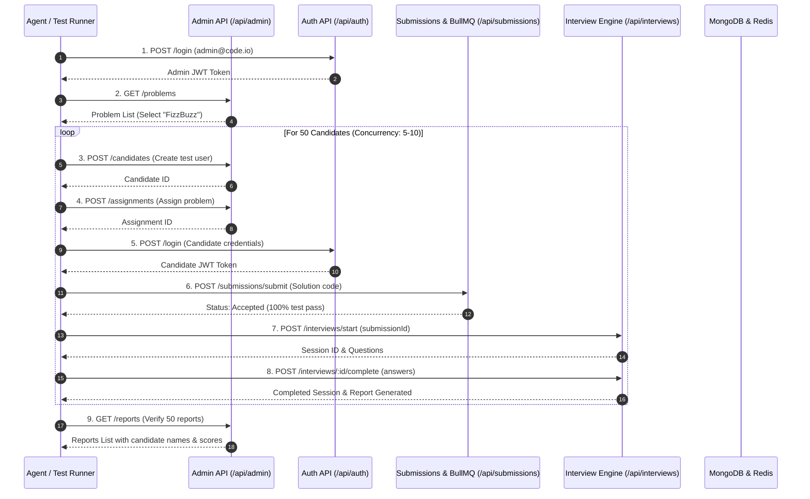

# Agent Load Testing Instructions: 50-Candidate Concurrent Assessment Pipeline

This document provides complete, step-by-step instructions for AI Agents and Quality Engineering automation to execute, monitor, and analyze an end-to-end load test simulating **50 concurrent candidates** on the CodeArena platform.

---

## 1. Overview & Objective

The objective of this load test is to validate system stability, queue concurrency, and reporting accuracy under a workload of **50 simultaneous candidates**:
1. **Admin Authentication**: Admin logs in to obtain administrative privileges.
2. **Problem Selection**: Admin selects a target problem (e.g., `FizzBuzz` or `Two Sum`).
3. **Candidate Provisioning**: Admin creates 50 test users via the Admin API (`POST /api/admin/candidates`).
4. **Assessment Assignment**: Admin assigns the chosen problem to all 50 candidates (`POST /api/admin/assignments`).
5. **Candidate Authentication**: Each candidate logs in (`POST /api/auth/login`) to receive a JWT session.
6. **Question Solving & Code Submission**: Each candidate submits passing solution code to `/api/submissions/submit`, exercising the BullMQ Redis queue and sandbox compilation/execution engine.
7. **Interview & Report Generation**: Each candidate starts an interview session (`POST /api/interviews/start`) and completes it (`POST /api/interviews/:sessionId/complete`), triggering automatic creation of a formal `Report` document.
8. **Report Verification**: Admin queries `GET /api/admin/reports` to verify that reports exist with valid candidate names, scores, and evaluations.
9. **Metrics & Benchmark Profiling**: Latency metrics (Min, Avg, P50, P90, P95, Max) and throughput are recorded.
10. **Optional Teardown**: Test accounts are deactivated to maintain clean database hygiene.

---

## 2. System Architecture & Prerequisites

Before running the load test, verify that the following infrastructure services are active:

| Service | Port | Protocol / Path | Purpose |
| :--- | :--- | :--- | :--- |
| **Node.js Backend** | `5001` | `http://localhost:5001/api` | REST API, BullMQ Worker, Auth & Assessment Engine |
| **MongoDB** | `27017` | `mongodb://localhost:27017/codearena` | Data persistence for Users, Problems, Submissions, Reports |
| **Redis** | `6379` | `redis://127.0.0.1:6379` | BullMQ Job Queue for code execution and rate limiting |
| **Piston Sandbox** | `2000` | `http://127.0.0.1:2000/api/v2/execute` | Isolated sandbox execution |
| **Host OpenJDK** | Local | `/usr/bin/javac` & `/usr/bin/java` | High-speed native Java compilation/execution fallback |

### Quick Pre-flight Health Check
Run the following curl command to verify backend responsiveness:
```bash
curl -s http://localhost:5001/api/health
# Expected: {"status":"ok", ...}
```

---

## 3. End-to-End Execution Flow (Agent Protocol)



---

## 4. Detailed Step-by-Step API Specification

### Stage 1: Admin Authentication
- **Endpoint**: `POST /api/auth/login`
- **Headers**: `Content-Type: application/json`
- **Request Body**:
  ```json
  {
    "email": "admin@code.io",
    "password": "admin123"
  }
  ```
- **Success Criteria**: HTTP 200, save `token` as `adminToken`.

---

### Stage 2: Target Problem Discovery
- **Endpoint**: `GET /api/problems`
- **Headers**: `Authorization: Bearer <adminToken>`
- **Action**: Search for problem with title `"FizzBuzz"` (or fallback to first problem). Capture `targetProblem._id`.
- **Target Java Solution Code (FizzBuzz)**:
  ```java
  import java.util.*;

  public class Solution {
      public static void main(String[] args) {
          Scanner sc = new Scanner(System.in);
          if (!sc.hasNextInt()) return;
          int n = sc.nextInt();
          for (int i = 1; i <= n; i++) {
              if (i % 15 == 0) System.out.println("FizzBuzz");
              else if (i % 3 == 0) System.out.println("Fizz");
              else if (i % 5 == 0) System.out.println("Buzz");
              else System.out.println(i);
          }
          sc.close();
      }
  }
  ```

---

### Stage 3: Provisioning 50 Test Candidates via Admin API
- **Endpoint**: `POST /api/admin/candidates`
- **Headers**:
  ```http
  Content-Type: application/json
  Authorization: Bearer <adminToken>
  ```
- **Request Body (per candidate `i` from 1 to 50)**:
  ```json
  {
    "name": "LoadTest Candidate 001",
    "email": "loadtest_<timestamp>_001@loadtest.codearena.io",
    "password": "TestPassword123!"
  }
  ```
- **Concurrency Recommendation**: Use a worker pool with concurrency limit of **5 to 10** to avoid port exhaustion and MongoDB connection spikes.
- **Success Criteria**: HTTP 201, capture `_id` as `candidateId`.

---

### Stage 4: Assessment Assignment
- **Endpoint**: `POST /api/admin/assignments`
- **Headers**:
  ```http
  Content-Type: application/json
  Authorization: Bearer <adminToken>
  ```
- **Request Body**:
  ```json
  {
    "candidateId": "<candidateId>",
    "assessmentId": "<targetProblemId>",
    "dueDate": "<7 days in future ISOString>"
  }
  ```
- **Success Criteria**: HTTP 201, capture `_id` as `assignmentId`.

---

### Stage 5: Candidate Authentication
- **Endpoint**: `POST /api/auth/login`
- **Headers**: `Content-Type: application/json`
- **Request Body**:
  ```json
  {
    "email": "loadtest_<timestamp>_001@loadtest.codearena.io",
    "password": "TestPassword123!"
  }
  ```
- **Success Criteria**: HTTP 200, capture `token` as `candidateToken`.

---

### Stage 6: Code Submission & BullMQ Queue Execution
- **Endpoint**: `POST /api/submissions/submit`
- **Headers**:
  ```http
  Content-Type: application/json
  Authorization: Bearer <candidateToken>
  ```
- **Request Body**:
  ```json
  {
    "code": "<Java Solution Code>",
    "problemId": "<targetProblemId>",
    "language": "java"
  }
  ```
- **Queue Behavior**:
  - Pushes job to BullMQ queue `code-execution`.
  - Processed by background worker with `CONCURRENCY_LIMIT = 5`.
  - Native Java executor compiles with `javac` and executes against test cases.
- **Success Criteria**: HTTP 201, `status: "Accepted"`, `codingPassed: true`, capture `submission._id`.

---

### Stage 7: Interview Assessment & Report Generation
- **Start Interview**:
  - **Endpoint**: `POST /api/interviews/start`
  - **Headers**: `Authorization: Bearer <candidateToken>`
  - **Body**: `{ "submissionId": "<submissionId>" }`
  - **Returns**: `sessionId`, `questions: [{ qid, question, ... }]`
- **Complete Interview**:
  - **Endpoint**: `POST /api/interviews/:sessionId/complete`
  - **Headers**: `Authorization: Bearer <candidateToken>`
  - **Body**:
    ```json
    {
      "answers": [
        {
          "qid": "<questions[0].qid>",
          "answer": "The solution iterates from 1 to n applying modular division to print Fizz, Buzz, or FizzBuzz.",
          "answerType": "typed"
        }
      ]
    }
    ```
- **Automatic Report Generation**:
  - The controller computes overall score (30% coding + 70% interview).
  - Automatically creates/upserts a formal `Report` in the `reports` collection.
  - Returns `status: "completed"`, `overallScore`, and `report`.

---

### Stage 8: Admin Report Verification
- **Endpoint**: `GET /api/admin/reports?limit=100`
- **Headers**: `Authorization: Bearer <adminToken>`
- **Success Criteria**: HTTP 200, reports array contains documents where `user.email` matches the created test candidates, with populated candidate names and valid overall scores.

---

### Stage 9: Optional Teardown / Cleanup
- **Endpoint**: `DELETE /api/admin/candidates/:candidateId`
- **Headers**: `Authorization: Bearer <adminToken>`
- **Action**: Marks candidate `isActive: false` to keep database clean.

---

## 5. Automated Execution via Script

An automated load testing runner is available at [load_test_50_candidates.js](file:///home/labuser/Desktop/Project/3207854-CodeArena/3207854-CodeArena_v01/codearena/backend/load_test_50_candidates.js).

### Running the Load Test
```bash
# In directory: codearena/backend
npm run test:load
```

### CLI Parameters & Customization
| Flag | Description | Default | Example |
| :--- | :--- | :--- | :--- |
| `--candidates` | Number of test candidates | `50` | `npm run test:load -- --candidates=50` |
| `--concurrency` | Worker concurrency pool size | `5` | `npm run test:load -- --concurrency=10` |
| `--problem` | Target problem title | `FizzBuzz` | `npm run test:load -- --problem="Two Sum"` |
| `--cleanup` | Deactivate test candidates when done | `false` | `npm run test:load -- --cleanup=true` |

---

## 6. Performance Benchmarking & SLA Targets

When conducting the 50-candidate load test, the system should meet the following performance criteria:

| Operation | Target P50 Latency | Target P95 Latency | SLA / Max Error Rate |
| :--- | :--- | :--- | :--- |
| **Admin Candidate Creation** | `< 150ms` | `< 300ms` | `0% errors` |
| **Assessment Assignment** | `< 20ms` | `< 50ms` | `0% errors` |
| **Candidate Login** | `< 100ms` | `< 250ms` | `0% errors` |
| **Code Submission & Queue Exec** | `< 600ms` | `< 1200ms` | `< 1% errors` |
| **Interview & Report Generation** | `< 2000ms` | `< 5000ms` | `< 1% errors` |
| **Overall Throughput** | `> 60 candidates / min` | `> 40 candidates / min` | `99%+ Success Rate` |

---

## 7. Troubleshooting & Recovery Matrix

| Issue / Error | Root Cause | Agent Remediation Step |
| :--- | :--- | :--- |
| **400 "Email already registered"** | Timestamp collision in candidate email | Use high-resolution timestamps + UUID: `Date.now() + "_" + index`. |
| **500 "Submission validation failed: status"** | Status enum mismatch in Mongoose | Status enum in `Submission.js` includes `Accepted`, `Wrong Answer`, `Runtime Error`, `Compilation Error`, `Time Limit Exceeded`, `System Error`. |
| **400 "No recorded or typed answers"** | Interview completed with empty answers | Pass at least one answered question referencing `questions[0].qid` from `startInterview`. |
| **429 "Too Many Requests"** | Groq / LLM rate limits hit by parallel interviews | The runner uses concurrency control (`concurrency: 5`) to stay within rate limits. |
| **Redis Connection Refused** | Redis container stopped | Start Redis container: `docker start codearena-redis` or verify port `6379`. |
| **Piston Unknown Runtime** | Java runtime not loaded in Piston container | Backend automatically routes Java code to the high-speed host native `javac`/`java` executor. |
